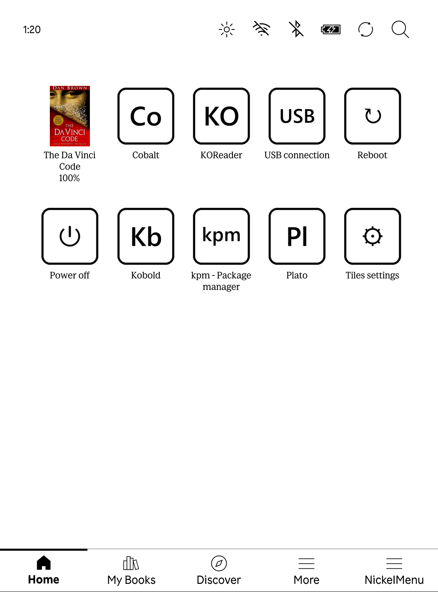
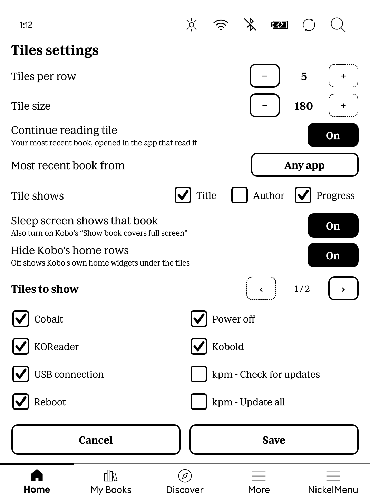

# NickelTiles

A grid of app tiles on the Kobo home screen. Built on
[NickelHook](https://github.com/pgaskin/NickelHook), like NickelMenu and
NickelHome.

<p align="center">
  
  &nbsp;
  
</p>

- **Your NickelMenu entries as tiles.** Every main-menu entry in
  `.adds/nm/` becomes a tile automatically (KOReader, Plato, USB connection,
  reboot, KPM, ...). Add or remove an entry and the grid follows.
- **Continue reading.** One tile always holds your most recent book, whichever
  app you read it in: KOReader, Plato or Kobo's own reader. It shows the cover
  (or a book icon, if you prefer) with any of title, author and progress under
  it, and opens the book in the app that last read it. Covers are read from
  EPUB, KEPUB, FB2, MOBI, AZW3 and CBZ books; others (PDF, for example) show
  the book icon.
- **Sleep screen follows that book.** With Kobo's *Show book covers full
  screen* setting on, the sleep screen shows the same book's cover, not just
  the last book opened in Kobo's reader.
- **Settings on the reader.** The *Tiles settings* tile opens a page for
  tiles per row, tile size, which tiles are shown, and the options above.
  Changes apply at once.
- **Repair switched-off add-ons.** The settings page lists NickelHook add-ons
  (NickelMenu, KPM, NickelHome, ...) that a crash left switched off, and turns
  them back on with one tap.
- **Arrange.** Long-press a tile, then tap another one to swap them.
- **E-ink friendly.** Black on white; a tile darkens while pressed.

## Status

Early. Developed and tested on one reader: a Tolino Shine 5 (T302, Clara BW
hardware) running Kobo's Clara BW firmware **4.45.23697**. Other recent
firmware (4.23.15505 and later, which share the home screen layout) may work
but is untested. Reports welcome, even "it works", here or in the
[MobileRead thread](https://www.mobileread.com/forums/showthread.php?p=4615824#post4615824).

NickelHook's failsafe applies: if Nickel crashes within 3 seconds of the mod
loading, the mod disables itself (its library is renamed to
`libnickeltiles.so.failsafe`) and Nickel starts normally. Installing the
package again re-enables it.

## Install

**With KPM** (the Kobo package manager), add the repository, then fetch and
stage the latest release, and restart the reader:

```sh
kpm add https://github.com/marin-o/NickelTiles --name nickeltiles
kpm check
kpm update nickeltiles
```

Updates arrive the same way (`kpm check`, `kpm update nickeltiles`, restart).
Restarting yourself rather than with `--reboot` (or KPM's "Update all" menu
entry, which uses it) avoids a KPM 0.11.0 issue where the reboot leaves its
lock file behind and KPM keeps reporting the update as staged.

**By hand**: download `KoboRoot.tgz` from the latest release, copy it into the
`.kobo` folder on the reader over USB, eject and unplug. The reader installs it
and restarts.

NickelMenu is optional; without it the grid has the built-in tiles and any
`tile:` lines from the config.

## Use

The grid replaces Kobo's home rows. To keep Kobo's own home widgets under the
tiles, turn off *Hide Kobo's home rows* in Tiles settings. Tiles size
themselves to fill the screen's width; set a fixed size there if you prefer.

| Action | What happens |
| --- | --- |
| Tap a tile | Runs it (the tile darkens while pressed) |
| Long-press a tile, tap another | Swaps the two; the order is saved |
| *Tiles settings* tile | Settings page; Save applies at once, Cancel discards |

Everything is also in a text file, `.adds/nickel-tiles/config` (edits there
need a reboot). The installed `.adds/nickel-tiles/doc` lists every key.
Custom icons: `.adds/nickel-tiles/icons/<label>.png`, where the label is lower
case with spaces as `-` (e.g. `kpm-status.png`), 200x200 recommended.

### Sleep screen

Kobo only uses a custom sleep image when **Settings > Energy saving and
privacy > Show book covers full screen** is on. NickelTiles keeps the image as
`.kobo/screensaver/nt-recent.<ext>` and refreshes it as the reader goes to
sleep. If you keep your own pictures in that folder, NickelTiles stays out of
it, so your sleep screens remain the ones you chose. Turn the feature off on
the settings page (or `nt_sleep_cover:0`).

### Switched-off add-ons

If Kobo crashes within a few seconds of starting (it can happen when an app
hands control back to Kobo), NickelHook add-ons switch themselves off to avoid
a crash loop, and stay off: NickelMenu disappears, KPM's window no longer
opens, and so on. *Tiles settings > Switched-off add-ons* lists them; Repair
turns them back on and offers to restart the reader now or later (they load
at the next restart). The button waits until Kobo has
been running for 30 seconds, because every add-on is briefly in that state
while it starts.

NickelTiles cannot repair itself: if the tiles are gone, install the package
again (KPM or `KoboRoot.tgz`).

## Uninstall

Through KPM, or create an empty file named `uninstall` in
`.adds/nickel-tiles/` and reboot (deleting the folder works too). The mod
removes its library on the next start.

## Build

Needs the [NickelTC](https://github.com/pgaskin/NickelTC) toolchain (GCC 4.9,
Qt 5.2.1). Releases are built by GitHub Actions in the NickelTC image, with a
build provenance attestation for `KoboRoot.tgz`. The same build locally:

```sh
git clone --recursive https://github.com/marin-o/NickelTiles
cd NickelTiles
docker run --rm -v "$PWD:/src" -w /src ghcr.io/pgaskin/nickeltc:1.0 \
  sh -c 'sh tools/patch-nickelhook.sh && make all koboroot'
```

Without Docker, with NickelTC unpacked somewhere:

```sh
git clone --recursive https://github.com/marin-o/NickelTiles
cd NickelTiles
NICKELTC_BASE=/path/to/nickeltc tools/build.sh      # -> KoboRoot.tgz
NICKELTC_BASE=/path/to/nickeltc LIBNICKEL=/path/to/libnickel.so.1.0.0 tools/check-syms.sh
```

`tools/build.sh` patches the NickelHook submodule to accept weakly bound
symbols (the home page hook, `Ui_HomePageView::setupUi`, is one).
`tools/check-syms.sh` checks every hooked symbol against a firmware's
`libnickel.so` and the package contents. `docs/architecture.md` maps the
modules; `docs/homepage-map.md` describes the home screen widget tree this
relies on.

## Notes

- A NickelMenu entry that rescans the library won't run from a tile;
  NickelTiles refuses it on purpose, because on the development device a
  rescan deleted sideloaded books. The same entry still works from
  NickelMenu's own menu.
- Plato books open Plato itself, not the book (Plato has no open-at-launch
  option).

## Contributing

Bug reports and pull requests are welcome; see [CONTRIBUTING.md](CONTRIBUTING.md).
Pull requests go to the `dev` branch.

## License

MIT. See [LICENSE](LICENSE).
